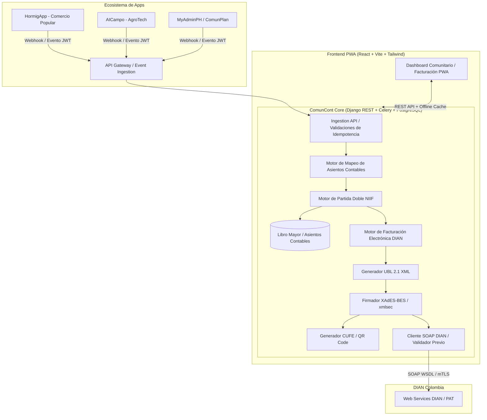

# Arquitectura del Módulo Contable "ComunCont"
## Ecosistema Comunidades Inteligentes (Colombia)

ComunCont actúa como el núcleo transaccional, contable bajo NIIF para microempresas / Entidades Sin Ánimo de Lucro (ESAL/JAC) y motor de facturación electrónica y documento equivalente ante la DIAN (Anexo Técnico 1.9 / UBL 2.1).

### Arquitectura General

